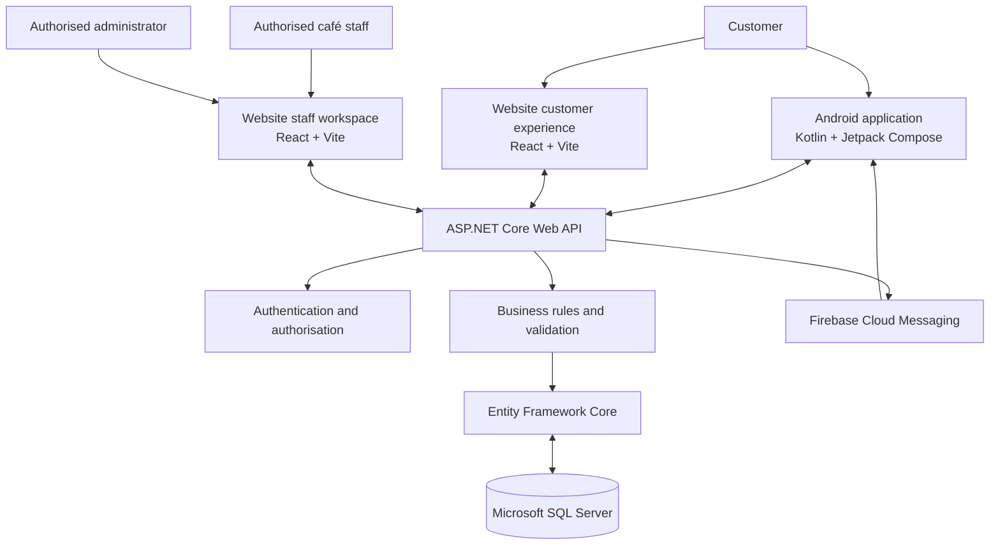

# ☕ Skinner Cafe


### Integrated Café Website, Android Application and Management Platform

**A connected digital platform for convenient customer ordering and
coordinated café operations.**

[](https://github.com/zwelakhedev/Skinner_Cafe_App_And_Website)
[](#-android-mobile-application)
[](#-website-platform)
[](#-backend-and-api)
[](#-database-and-data-management)

[**Download Android
APK**](https://github.com/zwelakhedev/Skinner_Cafe_App_And_Website/releases/tag/v1.0.0)
 •  [**View source
code**](https://github.com/zwelakhedev/Skinner_Cafe_App_And_Website)  • 
[**View
releases**](https://github.com/zwelakhedev/Skinner_Cafe_App_And_Website/releases)  •  [**▶️ Watch project demo**](https://youtu.be/WHEd1KEoX04)
:::

------------------------------------------------------------------------

## Table of contents

1.  [Executive summary](#1-executive-summary)
2.  [Background and problem
    statement](#2-background-and-problem-statement)
3.  [Purpose, aim and objectives](#3-purpose-aim-and-objectives)
4.  [Target audience and
    stakeholders](#4-target-audience-and-stakeholders)
5.  [Proposed solution and system
    scope](#5-proposed-solution-and-system-scope)
6.  [Expected outcomes and impact](#6-expected-outcomes-and-impact)
7.  [System architecture](#7-system-architecture)
8.  [Technology stack](#8-technology-stack)
9.  [Android mobile application](#9-android-mobile-application)
10. [Website platform](#10-website-platform)
11. [Backend and API](#11-backend-and-api)
12. [Database and data management](#12-database-and-data-management)
13. [Core business workflows](#13-core-business-workflows)
14. [Security, privacy and
    reliability](#14-security-privacy-and-reliability)
15. [User interface and
    accessibility](#15-user-interface-and-accessibility)
16. [Repository structure](#16-repository-structure)
17. [Development setup](#17-development-setup)
18. [Running the system locally](#18-running-the-system-locally)
19. [Build and release](#19-build-and-release)
20. [Testing and quality assurance](#20-testing-and-quality-assurance)
21. [Website screenshots](#21-website-screenshots)
22. [Android application
    screenshots](#22-android-application-screenshots)
23. [Google Play Store listing and promotional
    assets](#23-google-play-store-listing-and-promotional-assets)
24. [Download and installation](#24-download-and-installation)
25. [Demonstration and supporting
    documentation](#25-demonstration-and-supporting-documentation)
26. [Project outcomes and future
    development](#26-project-outcomes-and-future-development)
27. [Acknowledgements and responsible
    development](#27-acknowledgements-and-responsible-development)
28. [Author and project links](#28-author-and-project-links)

------------------------------------------------------------------------

## 1. 📋 Executive summary

Skinner Cafe is an integrated digital platform designed to modernise the
way a café presents its products, receives customer orders and
coordinates the fulfilment of those orders. The solution brings together
a responsive website, a native Android mobile application, a shared
application programming interface (API) and a central Microsoft SQL
Server database. Rather than treating the website and mobile application
as separate products, the system uses a common backend and shared
business rules so that customer and operational information is managed
consistently.

The project addresses a practical service-delivery problem: customers
increasingly expect to discover products, make selections and place
orders through convenient digital channels, while café staff need a
dependable way to receive, review and prepare those orders. A
disconnected or predominantly manual process can create avoidable
communication, inconsistent records and uncertainty about order
progress. Skinner Cafe provides a structured digital workflow intended
to reduce these points of friction.

The Android application focuses on the mobile customer experience. It
provides access to the menu, product options, cart, checkout, customer
account and order-history features. The website complements the
application by providing a browser-based customer channel and the
designated environment for authorised staff operations. Staff workflows
are kept separate from the customer-facing mobile application. This
division allows customers to use a straightforward ordering experience
while staff work with the operational functions required to process
orders.

The backend is implemented with ASP.NET Core and exposes REST-style
endpoints consumed by both clients. It is responsible for validating
requests, applying business rules, enforcing access permissions and
communicating with SQL Server through the application's data-access
layer. The database provides a centralised relational store for
customer, menu, product, order and payment-workflow information.
Authentication, account protection, order validation and status-driven
customer communication are treated as system-wide concerns rather than
isolated interface features.

The project is intended to demonstrate a complete, maintainable software
solution: one that connects customer-facing applications to operational
processes through a shared and structured architecture. Its expected
value lies in improved ordering convenience, clearer communication,
better order traceability and a foundation that can be extended as the
café's digital and operational needs grow.

> **Release and integration note:** The Android APK is distributed
> through the GitHub Releases link above. The payment workflow described
> in this project is a simulation and does not process real funds. A
> Google Play Store listing and production service URLs should only be
> added after the relevant publication and deployment steps have been
> completed.

## 2. 🔎 Background and problem statement

### 2.1 Background

A café must coordinate several related activities during normal service:
presenting an accurate menu, communicating product options, recording
customer selections, receiving orders, determining payment outcomes,
preparing products and informing customers when their orders are ready.
These activities are closely connected. A weakness in one part of the
process can affect the customer experience and the efficiency of the
staff responsible for fulfilment.

Traditional in-person ordering remains important, but it does not always
provide the flexibility expected by customers who prefer to browse or
place orders before arriving. A website and mobile application can
extend access to the café's services, but only if the channels are
supported by dependable shared data and a coherent order process.

### 2.2 Problem statement

When menu information, customer details and order records are maintained
through disconnected interfaces or manual processes, a café can
experience:

-   **Limited customer access:** customers may need to visit or contact
    the café to obtain information that could be presented digitally.
-   **Order-entry errors:** manually relaying product selections,
    variants or add-ons can introduce misunderstandings, omissions or
    duplication.
-   **Unclear order progress:** customers may not know whether an order
    has been received, accepted, is being prepared or is ready for
    collection.
-   **Fragmented information:** separate systems can hold inconsistent
    product, customer or order details.
-   **Administrative pressure:** staff may spend time answering
    repetitive status enquiries or transferring information between
    tools.
-   **Difficult expansion:** tightly coupled software can make it harder
    to introduce additional channels or operational capabilities without
    disrupting existing functionality.

The central problem addressed by Skinner Cafe is therefore the absence
of a unified digital process that connects customer ordering with the
information and actions required to fulfil an order. The solution must
do more than provide attractive screens: it must validate transactions,
preserve consistent records, protect customer information and
communicate meaningful order-state changes.

### 2.3 Project response

Skinner Cafe addresses this problem through a shared-service
architecture. The website and Android application provide different
access channels, while the ASP.NET Core API applies common validation
and business rules and the SQL Server database maintains the system's
persistent records. The staff-facing website workflow connects
operational decisions---particularly order confirmation and preparation
status---to the customer-facing order experience.

## 3. 🎯 Purpose, aim and objectives

### 3.1 Purpose

The purpose of Skinner Cafe is to design and deliver an integrated café
platform that improves the digital customer journey and supports the
operational activities involved in managing customer orders. The project
combines user-centred interface design with backend services, relational
data management and controlled access to operational functions.

### 3.2 Overall aim

To provide a coherent, secure and maintainable digital environment
through which customers can discover the café's menu and place orders
using a website or Android application, while authorised staff can
process those orders through a dedicated web-based operational
interface.

### 3.3 Specific objectives

1.  **Provide multiple customer access channels:** offer a responsive
    website and a native Android application so customers can use the
    channel most convenient to them.
2.  **Centralise menu information:** retrieve product, category, variant
    and add-on information from shared backend services.
3.  **Digitise order capture:** allow customers to build a cart and
    submit structured orders without relying on staff to manually
    re-enter each selection.
4.  **Validate transactions:** verify product selections, quantities,
    variants, add-ons and relevant business rules on the server.
5.  **Improve order transparency:** provide customers with order
    references, order history and meaningful status information.
6.  **Connect customer and staff workflows:** allow authorised staff to
    review and update orders, with customer-facing information
    reflecting valid backend status changes.
7.  **Support customer accounts:** provide registration, authentication,
    account information and profile-management capabilities.
8.  **Protect information:** apply authentication, authorisation, secure
    credential handling, transport security and server-side validation.
9.  **Maintain a shared data source:** use a relational database
    accessed through the API rather than allowing client applications to
    maintain separate authoritative records.
10. **Support maintainability:** organise the solution into distinct
    application, API, database and documentation components.
11. **Demonstrate software quality:** use version control, repeatable
    builds, testing and technical documentation to support reliable
    development.
12. **Provide a foundation for growth:** structure the platform so
    additional operational and customer features can be introduced
    without redesigning the entire solution.

## 4. 👥 Target audience and stakeholders

  -----------------------------------------------------------------------
  Audience                            Needs and value provided
  ----------------------------------- -----------------------------------
  New customers                       Discover the café, review available
                                      products and understand the
                                      ordering process before placing an
                                      order.

  Returning customers                 Access account information, repeat
                                      the ordering process more
                                      conveniently and review previous
                                      orders.

  Mobile-first customers              Use the Android application for a
                                      focused experience on a compatible
                                      Android device.

  Browser-based customers             Access the café through a desktop,
                                      tablet or mobile browser without
                                      installing the Android application.

  Café staff                          Use an authorised website workspace
                                      to review incoming orders and
                                      manage fulfilment status.

  Café administrators and management  Oversee authorised users and
                                      operational information, subject to
                                      the permissions provided by the
                                      system.

  Project owner and maintainers       Maintain the codebase, review
                                      system behaviour, manage releases
                                      and extend the platform.
  -----------------------------------------------------------------------

The interface is intended to be understandable to people with different
levels of technical confidence. Common customer tasks---finding a
product, choosing options, reviewing a cart and checking an
order---should be discoverable without requiring specialist knowledge.

## 5. 💡 Proposed solution and system scope

### 5.1 Solution overview

Skinner Cafe consists of four cooperating elements:

1.  **Android application:** a native mobile interface for customers.
2.  **Website:** a responsive browser interface for customers and an
    authorised staff workspace for café operations.
3.  **Backend API:** a shared service layer that validates requests,
    enforces permissions and coordinates business operations.
4.  **Relational database:** a central store for the information
    required by the platform.

The separation of these responsibilities is deliberate. The clients are
responsible for presenting information and collecting user input. The
API is responsible for determining whether an operation is valid and
permitted. The database preserves the resulting records and
relationships.

### 5.2 Functional scope

The platform's end-to-end scope covers:

-   Customer registration, authentication and account management.
-   Menu categories, products and product information.
-   Product variants and configurable add-ons.
-   Cart management and checkout.
-   Order creation and unique order references.
-   Guest order access where supported by the ordering flow.
-   Simulated payment outcomes for demonstration and workflow testing.
-   Customer order history and status visibility.
-   Staff review and processing of incoming orders through the website.
-   Order confirmation and preparation/ready-for-collection status
    changes.
-   Customer-facing notifications associated with relevant order-status
    changes.
-   Role-controlled access to staff and administrative functions.
-   Centralised storage, validation and retrieval of application data.

### 5.3 Separation of customer and staff responsibilities

The Android application is a customer application; it is not a staff
portal. Customers use it to browse, order, manage their account and
follow their orders. Staff-facing order processing belongs on the
website, where authorised users can access the operational workspace.
This separation keeps the mobile experience focused and ensures that
staff-only actions are protected by backend permissions rather than
merely hidden from the customer interface.

### 5.4 Payment scope

The project includes a simulated payment workflow to demonstrate the
user experience and the handling of payment outcomes. It can represent
success, failure and cancellation scenarios, including card,
digital-wallet, bank-app and QR-style flows. These are demonstrations
only: they do not charge a bank account, settle funds or replace a
certified payment gateway. A live payment service would require a
separately implemented and reviewed provider integration.

## 6. 🌟 Expected outcomes and impact

The platform is designed to produce value for customers, staff and the
café as an organisation.

### 6.1 Customer experience

-   **Greater convenience:** customers can access the menu and ordering
    journey through a website or Android application.
-   **More informed choices:** product details and supported options can
    be presented before an order is submitted.
-   **Clearer expectations:** order references and status information
    give customers a more understandable view of progress.
-   **Continuity:** account and order-history features provide a
    consistent experience for returning customers.
-   **Choice of channel:** customers are not required to install an
    application if they prefer a browser.

### 6.2 Operational support

-   **Structured order capture:** standardised order data reduces
    reliance on interpreting informal or manually transferred requests.
-   **Improved traceability:** persistent order records and status
    transitions provide a basis for reviewing what happened during
    fulfilment.
-   **Shared information:** staff and customers interact with
    information derived from the same backend records.
-   **Reduced repetitive communication:** timely status information can
    reduce the need for customers to contact staff simply to ask whether
    an order is ready.
-   **Role separation:** staff operations are organised separately from
    customer functionality.

### 6.3 Technical and organisational value

-   **Maintainability:** the separation of clients, API and database
    makes responsibilities easier to understand and change.
-   **Consistency:** shared business rules reduce the risk of the
    website and Android application applying different transaction
    logic.
-   **Extensibility:** the architecture can support additional
    reporting, inventory and operational capabilities as requirements
    are established.
-   **Data integrity:** server-side validation and relational
    constraints help protect the accuracy of stored records.

### 6.4 Evaluation of impact

The benefits above are expected outcomes, not claims of measured
business improvement. To evaluate actual impact after deployment, the
café could monitor indicators such as order-entry corrections, average
time between order submission and confirmation, average preparation
time, customer status enquiries, order completion rates and customer
feedback. A baseline should be recorded before comparing results over
time.

## 7. 🏗️ System architecture

### 7.1 High-level architecture



### 7.2 Architectural layers

  -----------------------------------------------------------------------
  Layer                   Components              Responsibility
  ----------------------- ----------------------- -----------------------
  Presentation            Android app and React   Display information,
                          website                 collect input, provide
                                                  navigation and
                                                  communicate results to
                                                  users.

  Application services    ASP.NET Core API        Expose endpoints,
                                                  coordinate workflows,
                                                  validate requests and
                                                  enforce access rules.

  Domain/business logic   API services and domain Apply ordering,
                          rules                   payment-simulation and
                                                  status-transition rules
                                                  consistently.

  Data access             Entity Framework Core   Map application
                                                  entities to relational
                                                  data and manage
                                                  database operations.

  Persistence             Microsoft SQL Server    Store users, products,
                                                  categories, orders and
                                                  related records.

  Notifications           Firebase Cloud          Deliver customer-facing
                          Messaging integration   push notifications for
                                                  relevant events when
                                                  configured and enabled.
  -----------------------------------------------------------------------

### 7.3 Typical request lifecycle

1.  A customer or authorised staff member performs an action in a client
    application.
2.  The client sends a request to the appropriate API endpoint over the
    configured connection.
3.  The API identifies the caller where authentication is required and
    checks the caller's permissions.
4.  The API validates the submitted data and applies the relevant
    business rules.
5.  The data-access layer reads or updates the required database
    records.
6.  The API returns a structured response to the client.
7.  The client presents the result and updates the interface.
8.  Where an eligible order-status event occurs, the notification
    workflow communicates the update to the customer.

### 7.4 Design principles

-   Separation of concerns between user interfaces, business rules and
    persistence.
-   A shared source of truth for menu, account and order data.
-   Server-side validation even when clients perform preliminary checks.
-   Least-privilege access for staff and administrative operations.
-   Explicit order-state transitions rather than arbitrary status
    changes.
-   Traceable changes and testable components.
-   Secure configuration that keeps secrets outside source control.

## 8. 🧰 Technology stack

  -----------------------------------------------------------------------
  Area                    Technology              Purpose
  ----------------------- ----------------------- -----------------------
  Android language        Kotlin                  Native Android
                                                  application
                                                  development.

  Android interface       Jetpack Compose         Declarative,
                                                  state-driven mobile UI.

  Android build           Gradle                  Dependency management,
                                                  compilation and
                                                  packaging.

  Website                 React                   Component-based browser
                                                  interface.

  Website tooling         Vite                    Local development
                                                  server and production
                                                  bundling.

  Website styling         Tailwind CSS and        Responsive styling and
                          reusable UI components  consistent interface
                                                  patterns.

  Backend                 ASP.NET Core Web API    Shared HTTP services
                                                  and application logic.

  Backend language        C#                      API and server-side
                                                  implementation.

  Data access             Entity Framework Core   Object-relational
                                                  mapping and database
                                                  access.

  Database                Microsoft SQL Server    Relational data
                                                  persistence.

  API documentation       OpenAPI / Swagger       Development-time
                          tooling                 endpoint inspection and
                                                  documentation.

  Authentication          ASP.NET Core Identity   Account identity and
                          and configured          access management.
                          authentication flows    

  Android sign-in         Google Credential       Google account sign-in
                          Manager integration     experience.

  Push notifications      Firebase Cloud          Customer notification
                          Messaging               delivery.

  Source control          Git and GitHub          Version history,
                                                  collaboration and
                                                  release hosting.

  Automation              GitHub Actions          Configured build and
                                                  test automation.

  Design                  Figma / Figma Make      Interface exploration
                                                  and prototyping.
  -----------------------------------------------------------------------

Exact tool and library versions are defined by the project files and
lockfiles in the relevant commit.

## 9. 📱 Android mobile application

The Android application is the mobile customer channel. It is built with
Kotlin and Jetpack Compose and uses a state-driven interface to present
the menu, ordering process and customer account features.

### 9.1 Customer features

-   **Home and navigation:** provides access to the main customer areas
    of the application.
-   **Menu browsing:** retrieves available menu categories and products
    through the shared API.
-   **Product details:** presents product information and supported
    variants or add-ons.
-   **Cart:** allows customers to review selected products and adjust
    their order before checkout.
-   **Checkout:** collects the information required to submit an order.
-   **Customer authentication:** supports account registration and
    sign-in.
-   **Google sign-in:** integrates the Google Credential Manager sign-in
    experience.
-   **My Orders:** provides access to customer order history and
    relevant order information.
-   **Guest order access:** supports access to an eligible guest order
    through its order-access mechanism.
-   **Profile management:** supports account information and
    profile-picture handling.
-   **Settings:** provides application preferences, including a
    persistent light/dark appearance preference.
-   **Push notifications:** integrates Firebase messaging for
    customer-facing order updates.

### 9.2 Customer order journey

1.  Open the application and browse the menu.
2.  Select a product and review its available options.
3.  Choose a supported variant and any applicable add-ons.
4.  Add the product to the cart.
5.  Review quantities and the order summary.
6.  Continue to checkout and provide the required details.
7.  Submit the order to the API.
8.  Receive the order reference and any applicable guest-access
    information.
9.  Review the order in My Orders or through the supported guest-access
    flow.
10. Receive relevant updates as the order progresses through staff
    processing.

### 9.3 Account and session handling

Account-related operations are handled through the backend
authentication system. The Android client maintains the session
information required by its configured authentication flow and protects
locally stored sensitive session material using Android security
facilities. Account-specific information must remain scoped to the
authenticated customer.

### 9.4 Payment demonstration

The mobile checkout experience can demonstrate payment outcomes such as
success, failure and cancellation. The application and API maintain
payment outcome as a separate concept from staff approval and
preparation status. A simulated successful payment must not be
interpreted as proof that an order has been approved or prepared.

### 9.5 Android project location

The Android project is located in:

``` text
Android/SkinnerCafe/
```

Main application source:

``` text
Android/SkinnerCafe/app/src/main/java/za/co/skinnercafe/app/
```

## 10. 🌐 Website platform

The website is the browser-based access point for Skinner Cafe. It is
developed with React and Vite and is intended to adapt to desktop,
tablet and mobile browser layouts.

### 10.1 Customer-facing website

The customer-facing website provides a browser alternative to the
Android application. It presents the café's digital experience without
requiring a customer to install a native application. Its integration
with the shared API allows it to use the same authoritative menu and
ordering data as the Android client.

Customer-facing website areas include:

-   Café landing page and brand information.
-   Menu and product discovery.
-   Product information and supported options.
-   Customer account and authentication experiences where enabled.
-   Cart and checkout journey.
-   Order-related information and customer support guidance.

### 10.2 Staff-facing website

The website is also the designated environment for authorised staff
operations. Staff functions are deliberately not placed in the Android
customer application.

The operational workflow is centred on the order lifecycle:

-   Review incoming customer orders.
-   Inspect order details and selected product options.
-   Confirm or approve an order according to the café's process.
-   Update preparation progress and mark an order ready for collection.
-   Ensure customer-facing order information reflects valid status
    changes.

Administrative capabilities can be extended to authorised menu,
inventory, supplier, staff and reporting functions as those modules are
implemented and enabled. All staff and administrative operations must be
protected by server-side role and permission checks.

### 10.3 Website project location

``` text
Web/
```

The website has its own package configuration and lockfile. Install
dependencies and run its scripts from the repository's `Web` project.

## 11. ⚙️ Backend and API

The ASP.NET Core Web API is the shared application service used by the
website and Android application. It provides a consistent interface to
business operations and prevents the clients from connecting directly to
the SQL Server database.

### 11.1 Main API responsibilities

-   Customer registration, authentication and session-related
    operations.
-   Current-user and profile-related information.
-   Menu categories and product retrieval.
-   Product variant and add-on validation.
-   Order creation and customer order retrieval.
-   Guest order access where supported.
-   Simulated payment request and outcome handling.
-   Authorisation of staff and administrative operations.
-   Database access, data validation and consistent response handling.
-   Order-status events used by customer-facing notification workflows.

### 11.2 Main controller areas

  -----------------------------------------------------------------------
  API area                            Responsibility
  ----------------------------------- -----------------------------------
  Auth                                Registration, login, logout,
                                      current-user information and
                                      profile operations.

  Menu                                Menu categories, products and
                                      related product information.

  Orders                              Order creation, order validation
                                      and customer order operations.

  Payments                            Simulated payment workflow and
                                      payment outcome handling.
  -----------------------------------------------------------------------

### 11.3 API project location

``` text
API/SkinnerCafe.API/
```

The API solution is maintained under:

``` text
API/SkinnerCafe.slnx
```

### 11.4 Environment configuration

Local and deployed environments must use separate configuration. Local
development can use .NET User Secrets or environment variables for
sensitive values. A deployed environment requires a publicly reachable
HTTPS endpoint, valid TLS certificates, secure database connectivity,
appropriate logging and operational monitoring.

The Android emulator's special host address `10.0.2.2` is only suitable
for reaching the development machine from an Android emulator. It is not
a production API address and will not work as the API host for ordinary
customer devices on the internet.

## 12. 🗄️ Database and data management

Microsoft SQL Server provides the relational persistence layer. Both
clients access data through the API; neither client connects directly to
the database.

### 12.1 Data responsibilities

The database supports the records and relationships required for:

-   Customer identity and profile information.
-   Menu categories and products.
-   Product variants and add-ons.
-   Customer orders and order items.
-   Payment simulation records and outcomes.
-   Operational records associated with order processing and authorised
    staff functions.

### 12.2 Data integrity

The relational design uses primary keys, foreign keys, constraints and
indexes to preserve relationships and support common queries. The API
validates business rules before writing records. Transaction boundaries
should be used where multiple related changes must succeed or fail
together.

### 12.3 Database documentation and backup

Database resources and supporting documentation are maintained in
`Database/` and `docs/`. A development/assessment backup is available
at:

``` text
Database/SkinnerCafe_Assessment.bak
```

Use the repository's restore guidance and scripts when preparing a local
database. A backup should be treated as a development artifact, not as a
substitute for a tested production backup and recovery plan.

## 13. 🔄 Core business workflows

### 13.1 Customer ordering

The customer selects products and supported options, reviews the cart
and submits the order. The API validates the submitted product
identifiers, variants, add-ons and quantities against authoritative data
before creating the order. The server, rather than the client, is
responsible for authoritative transaction validation and pricing rules.

### 13.2 Order confirmation and preparation

Order creation, payment outcome and staff approval are distinct business
events. After an order is submitted, authorised staff review it through
the website and apply the appropriate status transition. Staff can
subsequently update preparation progress and mark the order ready for
collection. The customer-facing application displays the resulting order
information.

### 13.3 Notifications

Customer notifications are associated with meaningful backend events,
particularly order confirmation and ready-for-collection status.
Notifications should be generated from valid status changes, not merely
from a client-side screen transition. Firebase Cloud Messaging provides
the Android push-notification integration; the application should also
present useful order information when the customer opens the
order-history experience.

### 13.4 Payment simulation

The payment demonstration supports success, failure and cancellation
paths so that the application can exercise different outcomes. Payment
simulation remains separate from order approval and preparation. Real
payment processing requires an approved payment provider and a
separately secured production integration.

## 14. 🔐 Security, privacy and reliability

Security is a cross-cutting requirement across the Android application,
website, API and database.

### 14.1 Identity and access control

-   Customer authentication is handled through the configured identity
    and authentication services.
-   Account-specific operations require an authenticated identity.
-   Staff and administrative operations require appropriate server-side
    authorization.
-   Public customer registration must never grant staff or administrator
    privileges.
-   Staff accounts are provisioned through controlled administrative
    processes.
-   The system design protects the last active administrator from being
    removed or demoted in a way that would leave the platform without an
    administrator.

### 14.2 Data and application security

-   Passwords must be stored using a suitable password-hashing
    mechanism, never as plaintext.
-   Deployed client-to-API communication must use HTTPS.
-   The API validates incoming data regardless of client-side
    validation.
-   File uploads must enforce appropriate size, type and content checks.
-   Session tokens, passwords, connection strings, certificates and
    signing keys must not be committed to source control.
-   Logs must not expose passwords, tokens, payment credentials or
    unnecessary personal information.
-   Database access must use appropriately restricted credentials.
-   Error responses should provide useful feedback without disclosing
    internal implementation details.

### 14.3 Privacy

The platform should collect only information required to provide its
services, explain how customer information is used, protect access to
account data and provide an appropriate privacy policy before public
distribution. Test screenshots and demonstrations must use sample
accounts and must not expose real customer information.

### 14.4 Production readiness

A production release requires a deployment-specific security review,
tested backups, monitoring, a valid privacy policy, secure API
configuration and end-to-end verification of the critical customer and
staff workflows.

## 15. 🎨 User interface and accessibility

The design aims to express the Skinner Cafe brand while keeping frequent
tasks clear and predictable.

Design principles include:

-   **Clarity:** understandable labels, readable content and a
    consistent hierarchy.
-   **Consistency:** reusable components, spacing, typography and colour
    rules.
-   **Responsive design:** layouts that adapt to desktop, tablet and
    mobile browsers.
-   **Mobile usability:** touch-friendly Android controls and
    predictable navigation.
-   **Feedback:** clear loading, validation, success, empty and error
    states.
-   **Accessibility:** readable contrast, meaningful labels, scalable
    text and controls that do not rely on colour alone.
-   **Error prevention:** validation and confirmation where mistakes
    could affect an order.
-   **Brand coherence:** consistent use of the Skinner Cafe logo and
    visual identity.

Design reference: **\[Add the Figma / Figma Make project URL here\]**.

## 16. 🗂️ Repository structure

The repository is organised as a monorepo so that the clients, API,
database resources, tests and documentation can be maintained together.

``` text
Skinner_Cafe_App_And_Website/
│
├── .github/
│   └── workflows/                  # GitHub Actions workflows
│
├── Android/
│   └── SkinnerCafe/                # Native Android application
│       ├── app/
│       ├── build.gradle.kts
│       ├── settings.gradle.kts
│       └── gradlew / gradlew.bat
│
├── API/
│   └── SkinnerCafe.API/            # ASP.NET Core Web API
│       ├── Controllers/
│       ├── Properties/
│       └── SkinnerCafe.API.csproj
│
├── Database/
│   ├── scripts/                    # Database scripts
│   └── SkinnerCafe_Assessment.bak  # Development/assessment backup
│
├── docs/
│   ├── assets/
│   │   ├── screenshots/
│   │   │   ├── website/
│   │   │   ├── android/
│   │   │   └── google-play/
│   │   └── evidence/
│   └── documentation and guides
│
├── tests/                          # Automated tests and test resources
│
├── Web/                            # React + Vite website
│   ├── src/
│   ├── public/
│   ├── package.json
│   └── pnpm-lock.yaml
│
└── README.md                       # Main project documentation
```

This is a high-level guide. Refer to the actual repository for the
complete and current file listing.

## 17. 🛠️ Development setup

### 17.1 Prerequisites

Install the tools needed for the components you intend to run:

-   Git.
-   Android Studio and a compatible JDK.
-   Android SDK platform and build tools required by the Android
    project.
-   .NET SDK matching the API target framework.
-   Node.js and pnpm.
-   SQL Server Express, Developer Edition or another compatible SQL
    Server instance.
-   SQL Server Management Studio or another compatible database tool.
-   Visual Studio Code or Visual Studio.

### 17.2 Clone the repository

``` powershell
git clone https://github.com/zwelakhedev/Skinner_Cafe_App_And_Website.git
cd Skinner_Cafe_App_And_Website
```

### 17.3 Configure local services

1.  Start a compatible SQL Server instance.
2.  Restore or create the development database using the repository's
    database documentation.
3.  Configure the API connection string using .NET User Secrets or
    another secure local configuration method.
4.  Configure the local API URL for the website and Android development
    build.
5.  Keep local certificates, credentials, signing material and
    environment-specific files out of Git.

Do not copy production credentials into local examples or commit secrets
to the repository.

## 18. 🚀 Running the system locally

The database, API and website run as separate processes. The Android
application can then be launched from Android Studio or installed on an
emulator/device.

### 18.1 Start the database

Start the SQL Server instance and confirm that the `SkinnerCafe`
development database is available. Use the restore guide in the
repository if the database needs to be restored from the supplied
backup.

### 18.2 Run the backend API

From the repository root:

``` powershell
dotnet restore .\API\SkinnerCafe.slnx
dotnet build .\API\SkinnerCafe.slnx
dotnet run --project .\API\SkinnerCafe.API
```

Use the configured local launch profile and verify that the API can
connect to the database. If Swagger/OpenAPI is enabled in the
development environment, use its configured local URL to inspect the
endpoints.

### 18.3 Run the website

Open a second terminal from the repository root:

``` powershell
pnpm.cmd --dir .\Web install --frozen-lockfile
pnpm.cmd --dir .\Web dev
```

Vite displays the local development URL in the terminal, commonly:

``` text
http://localhost:5173/
```

Open the URL shown by Vite in a browser.

To create a production website build:

``` powershell
pnpm.cmd --dir .\Web build
```

### 18.4 Run the Android application

Open `Android/SkinnerCafe/` in Android Studio, allow Gradle sync to
complete and select an Android emulator or connected device. Confirm
that the selected build configuration uses the correct API base URL.

From PowerShell:

``` powershell
cd .\Android\SkinnerCafe
.\gradlew.bat :app:assembleDebug
```

A debug APK is generated under:

``` text
app/build/outputs/apk/debug/app-debug.apk
```

The Android emulator's `10.0.2.2` address is a development-only route to
the host computer. A physical device requires a reachable development
network address and suitable certificate configuration, while a public
release requires a deployed HTTPS API endpoint.

## 19. 📦 Build and release

### 19.1 Android release artifacts

The Android project supports a signed release build. Signing credentials
must be stored locally or in a protected build environment and excluded
from version control.

Generate a signed release APK:

``` powershell
cd .\Android\SkinnerCafe
.\gradlew.bat assembleRelease
```

Generate an Android App Bundle for Google Play submission:

``` powershell
.\gradlew.bat bundleRelease
```

Expected output locations:

  Artifact      Output
  ------------- ----------------------------------------------------
  Release APK   `app/build/outputs/apk/release/app-release.apk`
  Release AAB   `app/build/outputs/bundle/release/app-release.aab`

Verify the APK signature with Android's `apksigner` before distributing
it. Keep a secure backup of the signing key and its credentials. Future
updates must use the appropriate signing identity.

### 19.2 GitHub Releases

The Android APK is available through the project's GitHub release:

[**Download Skinner Cafe Android APK ---
v1.0.0**](https://github.com/zwelakhedev/Skinner_Cafe_App_And_Website/releases/tag/v1.0.0)

The release page is the distribution point for the downloadable APK.
Review the release notes and device requirements before installing.

## 20. 🧪 Testing and quality assurance

Quality assurance covers individual components and the complete
customer-to-staff workflow.

  ---------------------------------------------------------------------------
  Test level              Purpose                     Example evidence
  ----------------------- --------------------------- -----------------------
  Unit testing            Verify isolated business    Test results and
                          rules and helper logic.     assertions.

  API testing             Verify endpoint responses,  Request/response
                          validation and permissions. records and test
                                                      results.

  Database testing        Verify relationships,       Database checks and
                          constraints and             test records.
                          persistence.                

  Android testing         Verify screen behaviour and Emulator and
                          mobile customer journeys.   physical-device test
                                                      evidence.

  Website testing         Verify navigation, forms    Browser test evidence.
                          and responsive layouts.     

  Integration testing     Verify                      End-to-end workflow
                          client-to-API-to-database   results.
                          communication.              

  Regression testing      Check that changes do not   Repeatable regression
                          break existing behaviour.   checklist.

  Security testing        Review authentication,      Security review
                          authorisation and           findings and
                          sensitive-data handling.    remediation records.
  ---------------------------------------------------------------------------

### 20.1 Core acceptance scenarios

-   Register a customer and validate the submitted information.
-   Sign in, restore a valid session and sign out.
-   Confirm that one customer cannot access another customer's protected
    information.
-   Browse menu categories and products from the API.
-   Select valid product variants and add-ons.
-   Add, update and remove cart items.
-   Submit an order and verify the persisted order details.
-   Verify guest order access where enabled.
-   Exercise simulated payment success, failure and cancellation.
-   Confirm that payment outcome and staff approval remain separate.
-   Review an order through the staff website workflow.
-   Confirm an order and update it to ready for collection.
-   Verify that the customer's order view reflects the actual backend
    status.
-   Verify push-notification behaviour on a physical Android device.
-   Test invalid input, unavailable network conditions and API errors.
-   Verify light/dark appearance preferences and responsive website
    layouts.

A successful build confirms that the relevant code compiled. It does
not, by itself, prove that every acceptance scenario passed. Record test
dates, application versions, device/browser details and results when
carrying out formal verification.

## 21. 🖥️ Website screenshots


### 21.1 Website landing page


**Screenshot name:** `website-home.png`\
**Description:** Introduce the Skinner Cafe brand, explain the website's
purpose and show the main navigation and customer entry points.


```{=html}
<!-- Add screenshot:  -->
```
### 21.2 Website menu and product catalogue

**Screenshot name:** `website-menu.png`\
**Description:** Show the menu categories, product presentation and the
way customers discover available items.

```{=html}
<!-- Add screenshot:  -->
```
### 21.3 Website product details

**Screenshot name:** `website-product-details.png`\
**Description:** Demonstrate product information and any supported
variants or add-ons.

## 22. 📸 Android application screenshots


## 23. 🏪 Google Play Store listing and promotional assets

### 23.1 Google Play app link

**App name:** Skinner Cafe\
**Android application ID:** `za.co.skinnercafe.app`\
**Google Play listing:**
N/A

**Direct APK download:** [Download Skinner Cafe APK from GitHub
Releases](https://github.com/zwelakhedev/Skinner_Cafe_App_And_Website/releases/tag/v1.0.0)

### 23.2 Store listing description

**Short description --- draft**

> Browse the Skinner Cafe menu, customise your order and follow its
> progress from your Android device.

**Full description --- draft**

> Skinner Cafe makes it easier to connect with your café through a
> convenient mobile ordering experience. Explore menu items, review
> product options, add selections to your cart and submit an order from
> your Android device.
>
> With customer account features and an order-history experience, you
> can return to relevant order information and follow progress as the
> café processes your order. The application is connected to the Skinner
> Cafe platform, helping keep menu and order information consistent
> across its digital channels.
>
> Skinner Cafe is designed to make the customer journey clearer and more
> convenient---from discovering products to receiving updates about an
> order.
>
> Payment options shown in demonstration builds may simulate payment
> outcomes and should not be interpreted as live payment processing.

Review this description against the exact functionality and policies of
the submitted Play Store build before publication.

### 23.43Google Play screenshot compartments

Add the actual store-ready screenshots below. Each image should be
accompanied by a concise caption describing the feature shown.


**Store screenshot 1 --- Menu discovery**\
File: `play-store-phone-01.png`\
Description: `Add a short description of the menu browsing experience.`

```{=html}
<!-- Add Google Play screenshot 1 here. -->
```
**Store screenshot 2 --- Product customisation**\
File: `play-store-phone-02.png`\
Description:
`Explain how customers view products and select available options.`

### 23.5 Publication evidence

  Evidence                      status
  ----------------------------- ----------------------------------------
  Play Console app dashboard     N/A
  Store listing preview          N/A
  Internal testing               N/A
  Closed testing, if required    N/A
  Content rating                 N/A
  Data safety                    N/A
  Privacy policy                 N/A
  Production review              N/A
  Public Play Store Listing      N/A

The Application Was Unfortunately Unable to Be Published on Google Play store and on Google Play Console Due To Financial Constraints

## 24. ⬇️ Download and installation

### 24.1 Download the Android APK

The signed Android APK is available from the project's GitHub Releases
page:

::: {align="center"}
### [⬇️ Download Skinner Cafe for Android](https://github.com/zwelakhedev/Skinner_Cafe_App_And_Website/releases/tag/v1.0.0)

**GitHub Release: `v1.0.0`**
:::

### 24.2 Installation instructions

1.  Open the GitHub release link on the Android device.
2.  Download the `app-release.apk` file from the release assets.
3.  Open the downloaded APK.
4.  If Android requests permission, allow installation from that source
    in the device settings.
5.  Return to the installer and complete installation.
6.  Open Skinner Cafe.

Only install APKs from a source you trust. Android may display a warning
when installing an application outside Google Play.

### 24.3 Device and service requirements

-   A compatible Android device running Android 8.0 (API level 26) or
    later.
-   An internet connection for API-backed functionality.
-   Access to the configured Skinner Cafe API service.
-   A valid customer account for account-specific functionality.

A locally built release APK is not independently connected to a public
backend merely because it installs successfully. The release
configuration must point to an accessible production API before general
customer distribution.

### ▶️ YouTube project demonstration

Watch the Skinner Cafe project demonstration, covering the platform and
its key customer and operational workflows:

[**▶️ Watch the Skinner Cafe Demo on YouTube**](https://youtu.be/WHEd1KEoX04)

## 26. 🔭 Project outcomes and future development

### 26.1 Intended project outcomes

Skinner Cafe brings the customer-facing and operational sides of a café
ordering process into one connected system. The Android application and
website provide complementary access channels, while the shared API and
database provide a consistent foundation for menu and order information.
The separation of customer and staff responsibilities supports a clearer
user experience and a more controlled operational workflow.

The project also demonstrates the application of several software
engineering principles: modular architecture, API-based integration,
relational data modelling, authentication and authorisation, input
validation, version control, build automation and structured technical
documentation.

### 26.2 Opportunities for future enhancement

The architecture can be extended as business needs and operational
evidence become clearer. Potential enhancements include:

-   Integration with a certified payment provider for real transactions.
-   More detailed inventory and stock-management workflows.
-   Supplier and purchasing management.
-   Advanced sales, order and operational reporting.
-   Customer loyalty and rewards features.
-   Promotional campaigns and customer notifications.
-   Further accessibility improvements and usability testing.
-   Expanded automated integration and end-to-end test coverage.
-   Production monitoring, analytics and operational alerting.
-   Additional platform support where justified by user demand.

Future development should be prioritised according to customer value,
operational need, security implications and maintainability.

## 27. 🙏 Acknowledgements and responsible development

### 27.1 Technologies and resources

The project draws on the documentation and tooling ecosystems of:

-   Android Developers --- Kotlin, Android and Jetpack Compose.
-   Microsoft Learn --- .NET, ASP.NET Core, Entity Framework Core and
    SQL Server.
-   React and Vite --- browser application development.
-   Firebase --- messaging and Android integration.
-   GitHub --- source control, repository hosting and release
    management.
-   Figma / Figma Make --- interface design exploration and prototyping.

### 27.2 Responsible use of AI-assisted tools

AI Tools Were Used for The debugging of Both The website and the application as well
and for the assistance of building particular functions within the app and the website.

## 28. 🔗 Author and project links

  ---------------------------------------------------------------------------------------------------------------------------------
  Resource                            Link
  ----------------------------------- ---------------------------------------------------------------------------------------------
  GitHub repository                   [Skinner_Cafe_App_And_Website](https://github.com/zwelakhedev/Skinner_Cafe_App_And_Website)

  Android APK release                 [Download
                                      v1.0.0](https://github.com/zwelakhedev/Skinner_Cafe_App_And_Website/releases/tag/v1.0.0)

  All GitHub releases                 [Releases](https://github.com/zwelakhedev/Skinner_Cafe_App_And_Website/releases)

  GitHub issues                       [Issues](https://github.com/zwelakhedev/Skinner_Cafe_App_And_Website/issues)

  Project owner / developer           Fezile Jam-Jam (zwelakhedev)

  LinkedIn                            `Add LinkedIn profile URL, if desired.`

  Demonstration video                 `Add video URL.`

  Google Play listing                 N/A Due To Financial Constraints
  ---------------------------------------------------------------------------------------------------------------------------------

------------------------------------------------------------------------

*Connecting customers, café staff and digital services through one
integrated platform.*

Built with a focus on convenience, consistency, secure information
handling and maintainable software architecture.
