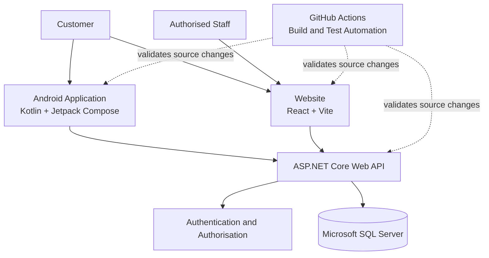

<div align="center">

# ☕ Skinner Cafe


### Integrated Café Website & Android Mobile Application

A connected digital experience for customers and café operations**

</div>

[](https://github.com/zwelakhedev/Skinner_Cafe_App_And_Website)
[](#-android-mobile-application)
[](#-backend-and-system-architecture)
[](#-database)
[](#-project-status)

**Repository:**
[zwelakhedev/Skinner_Cafe_App_And_Website](https://github.com/zwelakhedev/Skinner_Cafe_App_And_Website)
:::

------------------------------------------------------------------------

## 📑 Contents

-   [1. Project Overview](#-1-project-overview)
-   [2. Problem Statement](#-2-problem-statement)
-   [3. Project Purpose and
    Objectives](#-3-project-purpose-and-objectives)
-   [4. Target Audience and
    Stakeholders](#-4-target-audience-and-stakeholders)
-   [5. Proposed Solution and Expected
    Impact](#-5-proposed-solution-and-expected-impact)
-   [6. System Scope](#-6-system-scope)
-   [7. System Architecture](#-7-system-architecture)
-   [8. Technology Stack](#-8-technology-stack)
-   [9. Android Mobile Application](#-9-android-mobile-application)
-   [10. Website](#-10-website)
-   [11. Backend and System
    Architecture](#-11-backend-and-system-architecture)
-   [12. Database](#-12-database)
-   [13. User Interface and Design
    Considerations](#-13-user-interface-and-design-considerations)
-   [14. Security, Privacy and Data
    Integrity](#-14-security-privacy-and-data-integrity)
-   [15. Repository Structure](#-15-repository-structure)
-   [16. Development Environment and
    Setup](#-16-development-environment-and-setup)
-   [17. Running the Project](#-17-running-the-project)
-   [18. Testing and Quality
    Assurance](#-18-testing-and-quality-assurance)
-   [19. GitHub, Version Control and
    Collaboration](#-19-github-version-control-and-collaboration)
-   [20. GitHub Actions and Continuous
    Integration](#-20-github-actions-and-continuous-integration)
-   [21. Screenshots and Interface
    Evidence](#-21-screenshots-and-interface-evidence)
-   [22. Demonstration Video and
    Presentation](#-22-demonstration-video-and-presentation)
-   [23. Release Notes and Prototype-to-Current
    Development](#-23-release-notes-and-prototype-to-current-development)
-   [24. Publication and Release
    Evidence](#-24-publication-and-release-evidence)
-   [25. Installation and User
    Guidance](#-25-installation-and-user-guidance)
-   [26. Known Limitations and Future
    Enhancements](#-26-known-limitations-and-future-enhancements)
-   [27. Project Status](#-27-project-status)
-   [28. Acknowledgements and
    Attributions](#-28-acknowledgements-and-attributions)
-   [29. Responsible Use of AI-Assisted
    Tools](#-29-responsible-use-of-ai-assisted-tools)
-   [30. Author and Project Links](#-30-author-and-project-links)

------------------------------------------------------------------------

## ☕ 1. Project Overview

Skinner Cafe is a multi-platform café management and customer-engagement
project. It is designed around two connected customer-facing
channels---a responsive website and an Android mobile
application---supported by a shared ASP.NET Core Web API and a central
Microsoft SQL Server database.

The project addresses the need for a convenient, consistent and
digitally supported café experience. Customers should be able to
discover the café's products, explore menu information and place orders
through a familiar digital interface. The Android application provides a
mobile-first experience, while the website provides an accessible
browser-based channel. Both channels are intended to use the same
backend services and business data so that information is not maintained
independently in separate systems.

The wider solution is designed to support the café's operational
processes as the project develops. Customer ordering and order-status
communication form the core transaction workflow. A secure staff-facing
website area is intended to support operational activities such as order
handling and, as the system expands, inventory, supplier, staff,
scheduling, attendance, events and reporting processes.

The system is being developed as a structured software project rather
than as two unrelated interfaces. Its repository separates the Android
client, web client, API, database resources, documentation and tests.
This separation supports maintainability, traceability, testing and
future enhancement.

> **Implementation note:** This README distinguishes features that have
> been implemented or demonstrated in the development environment from
> features that remain planned, require end-to-end verification, or
> depend on deployment. A successful source-code build is not, by
> itself, proof that every user journey is production-ready.

## 🎯 2. Problem Statement

Cafés commonly need to coordinate menu information, customer orders,
payment outcomes and order preparation while serving customers through
in-person and digital channels. When these activities rely heavily on
manual communication or disconnected tools, several challenges can
arise:

-   Customers may have limited visibility of menu information and
    ordering options before visiting the café.
-   Orders may need to be captured or communicated manually, increasing
    the possibility of mistakes, duplication or delays.
-   Customers may not know whether an order has been received, approved
    or prepared for collection.
-   Separate website, mobile and operational records can lead to
    inconsistent information.
-   Staff may spend time repeating administrative tasks that could be
    supported by a centralized system.
-   A business may find it difficult to expand its digital services when
    its software is built as a single tightly coupled application.

Skinner Cafe responds to these challenges by developing a connected
platform in which the website and Android application communicate with a
shared API and database. The intended outcome is a clearer customer
journey and a more consistent foundation for café operations.

## 🎯 3. Project Purpose and Objectives

### 3.1 Primary purpose

The primary purpose is to design, implement and document a connected
digital platform that improves how customers interact with Skinner Cafe
and establishes a foundation for more efficient café operations.

### 3.2 Objectives

1.  **Improve customer convenience:** provide website and Android access
    to café information and digital ordering.
2.  **Support a consistent menu:** retrieve product and category
    information through shared backend services.
3.  **Digitize order capture:** submit customer orders with validated
    product variants and applicable add-ons.
4.  **Improve order visibility:** provide a customer-facing order
    history and a foundation for meaningful order-status updates.
5.  **Support secure accounts:** provide customer registration,
    authentication, profile management and account settings.
6.  **Centralize information:** use a shared relational database
    accessed through the API.
7.  **Separate responsibilities:** keep customer experiences distinct
    from staff operational tools and enforce authorization at the
    backend.
8.  **Promote software quality:** use version control, structured
    documentation, builds and automated/manual testing.
9.  **Prepare for release:** establish the evidence, packaging, signing
    and publication process required for a future Android release.

## 👥 4. Target Audience and Stakeholders

  -----------------------------------------------------------------------
  Audience / stakeholder              Needs addressed by the project
  ----------------------------------- -----------------------------------
  Café customers                      Browse products, create an account,
                                      place orders, review previous
                                      orders and receive relevant status
                                      information.

  Returning customers                 Access account-related information
                                      and a more convenient repeat-use
                                      experience.

  Café staff                          Use a planned secure website
                                      workflow to review and manage
                                      customer orders.

  Café administrators / management    Oversee operational information
                                      and, as the staff portal expands,
                                      manage authorized business
                                      functions.

  Project owner / developer           Maintain a modular codebase,
                                      demonstrate development progress
                                      and provide clear technical
                                      documentation.
  -----------------------------------------------------------------------

The design prioritizes customers who use either a smartphone or a
desktop/mobile browser. The system should remain understandable to users
with different levels of technical confidence.

## 🌟 5. Proposed Solution and Expected Impact

The solution consists of three main software layers:

1.  **Presentation layer:** the React website and Kotlin Android
    application.
2.  **Application layer:** the ASP.NET Core Web API, which validates
    requests and applies business rules.
3.  **Data layer:** the SQL Server database, which stores and relates
    the system's persistent information.

This architecture is intended to provide the following benefits:

-   **Consistent information:** both clients use shared services rather
    than maintaining separate menu and order databases.
-   **Improved customer experience:** customers can interact with the
    café through the channel that best suits them.
-   **Better order traceability:** order identifiers, stored order
    records and status transitions provide a basis for tracking.
-   **Reduced manual coordination:** digital order capture and
    customer-facing status information can reduce repetitive
    communication.
-   **Maintainability:** modular projects make it easier to change one
    layer without unnecessarily rewriting the others.
-   **Extensibility:** future modules can build on the shared identity,
    API and database foundation.

These are expected benefits of the intended solution. Actual business
impact---such as reduced waiting times or fewer order errors---must be
evaluated through real usage and measured operational evidence.

## 🧭 6. System Scope

### 6.1 In scope

-   Responsive customer-facing website.
-   Customer-facing Android application.
-   Shared ASP.NET Core REST API.
-   SQL Server database and database documentation.
-   Customer registration, login and profile-related functionality.
-   Menu and product browsing.
-   Cart and checkout experience.
-   Order creation and customer order history.
-   Simulated payment outcomes for demonstration and workflow testing.
-   Customer-facing order-status experience and notification integration
    as the order lifecycle is completed.
-   Secure staff-facing website functionality as a separate operational
    area.
-   Automated builds, testing, technical documentation and release
    preparation.

### 6.2 Outside the current confirmed scope

-   A native iOS application.
-   A third-party delivery fleet or courier platform.
-   Live financial settlement through a real payment gateway in the
    current simulated-payment implementation.
-   Claims of production deployment or Google Play publication before
    evidence is added to this repository.

### 6.3 Customer and staff responsibilities

The Android application is customer-facing. Staff order processing,
order approval and preparation-status management belong in the website's
staff-facing experience, not in an Android staff portal. The Android
application is intended to display customer-relevant order information
and notifications resulting from actual backend status changes.

## 🏗️ 7. System Architecture



### 7.1 Request flow

1.  A customer interacts with the website or Android application.
2.  The client sends an HTTP request to the relevant API endpoint.
3.  The API validates the request, checks authentication and
    authorization where required, and applies business rules.
4.  The API reads or updates the SQL Server database through the
    application's data-access layer.
5.  The API returns a structured response.
6.  The client updates the interface to reflect the response.

### 7.2 Architectural principles

-   **Separation of concerns:** UI code, API logic and persistent data
    are kept in distinct projects.
-   **Single source of truth:** shared business records are maintained
    by the backend and database.
-   **Validation at the boundary:** the API must validate incoming data
    even when the client also performs input checks.
-   **Least privilege:** staff-only operations must be protected by
    backend authorization, not merely hidden in the UI.
-   **Incremental development:** features are implemented and tested in
    manageable steps.

## 🧰 8. Technology Stack

  -----------------------------------------------------------------------
  Area                    Technology              Role
  ----------------------- ----------------------- -----------------------
  Android                 Kotlin                  Primary Android
                                                  application language

  Android UI              Jetpack Compose         Declarative mobile
                                                  interface

  Android build           Gradle                  Dependency management
                                                  and build automation

  Website                 React                   Component-based web
                                                  interface

  Website tooling         Vite                    Development server and
                                                  production bundling

  Website styling         Tailwind CSS and UI     Responsive styling and
                          components              reusable interface
                                                  elements

  Backend                 ASP.NET Core Web API    Shared REST services
                                                  and business logic

  Backend language        C#                      API implementation

  Database                Microsoft SQL Server    Relational persistence

  Data access             Entity Framework Core   Object-relational
                                                  mapping and database
                                                  access

  API documentation       OpenAPI / Swagger       API exploration during
                          tooling                 development

  Source control          Git and GitHub          Version history and
                                                  remote repository

  CI                      GitHub Actions          Automated build and
                                                  test workflows

  Design and prototyping  Figma / Figma Make      Interface exploration
                                                  and visual prototyping

  Development tools       Android Studio, Visual  Coding, debugging and
                          Studio, Visual Studio   database management
                          Code, SQL Server tools  
  -----------------------------------------------------------------------

> Tool and framework versions can change during development. Refer to
> the relevant project configuration files and lockfiles for the exact
> versions used by a particular commit.

## 📱 9. Android Mobile Application

The Android application is the mobile customer channel for Skinner Cafe.
It is built with Kotlin and Jetpack Compose, with a focus on reusable
composables, state-driven UI and a consistent application theme.

### 9.1 Customer-facing functionality

The current Android implementation includes work in the following areas:

-   **Home:** customer landing experience and navigation to key areas.
-   **Menu:** product and category browsing, with menu data retrieved
    through the API.
-   **Product details:** product information and selection of available
    options.
-   **Cart:** review and adjustment of selected items before checkout.
-   **Checkout:** customer/order details and submission of an order.
-   **Authentication:** customer registration and login flows.
-   **Account and settings:** account-related navigation and persistent
    application preferences.
-   **My Orders:** customer order-history interface and order-related
    state handling.
-   **Profile image handling:** profile-picture upload/removal support
    in the account workflow.
-   **Theme preferences:** light/dark appearance preference persisted
    through application preferences.

The exact state of each feature should be confirmed through end-to-end
testing on a device before a production release.

### 9.2 Order journey

The intended customer order journey is:

1.  Browse the menu.
2.  Select a product and any supported variant or add-on.
3.  Add the item to the cart.
4.  Review the cart.
5.  Continue to checkout.
6.  Submit the order to the API.
7.  Receive an order reference and, where applicable, guest-access
    information.
8.  View the order in the customer order-history experience.
9.  Receive updates when staff change the order's status.

Order creation, payment outcome and staff approval are separate business
events. A successful simulated payment must not automatically be
interpreted as staff approval.

### 9.3 Payment demonstration

The project includes a simulated payment workflow to demonstrate
payment-related user journeys without processing real funds. The
implementation has been exercised with payment methods and
provider-style options such as card, digital wallet, bank-app and QR
flows.

**Important:** these flows are simulations. They must not be represented
as live payment integrations or real financial transactions. A
production deployment would require an approved payment provider, secure
server-side integration, reconciliation and appropriate compliance
controls.

### 9.4 Customer order notifications

The required customer experience includes status updates when an order
is approved/confirmed and when it is ready for collection. These
notifications must be driven by real backend order-status changes. The
staff approval action and payment result remain separate.

### 9.5 Android source locations

The Android project is located in `Android/SkinnerCafe/`. Main
application code is under:

`Android/SkinnerCafe/app/src/main/java/za/co/skinnercafe/app/`

Important code areas include:

-   `MainActivity.kt` --- main application UI and customer navigation
    surfaces.
-   `CheckoutScreen.kt` --- checkout experience.
-   `navigation/` --- navigation structure.
-   `data/api/` --- API models and repositories.
-   `ui/auth/` --- authentication screens and view-model logic.
-   `ui/orders/` --- customer order-history UI and view-model logic.
-   `ui/settings/` --- preferences and settings.
-   `ui/theme/` --- application colours, typography and theme
    definitions.

## 🌐 10. Website

The website is the browser-based channel for Skinner Cafe. It is
developed with React and Vite and is intended to provide a responsive
experience across desktop and mobile browsers.

### 10.1 Customer-facing purpose

The website provides a complementary way for customers to discover the
café and interact with its digital services without installing the
Android application. It is intended to share menu, account and ordering
capabilities through the common API.

### 10.2 Staff-facing purpose

The website is also the designated home for staff-facing operational
functionality. This separation keeps the Android application focused on
customers while allowing authorized staff to use a browser-based
workspace.

Planned staff workflows include:

-   Reviewing incoming orders.
-   Confirming or approving orders.
-   Updating preparation and ready-for-collection status.
-   Managing menu and inventory information.
-   Managing suppliers and relevant operational records.
-   Supporting staff, schedules and attendance.
-   Managing events and viewing reports.

These are project-scope capabilities; do not assume every listed staff
module is already implemented. Only mark a module as complete after it
is available in the codebase and verified.

### 10.3 Website source location

The website is located in the `Web/` directory. It has its own package
configuration and should be installed and built from that directory.

## 🔌 11. Backend and System Architecture

The backend is an ASP.NET Core Web API shared by the Android and web
clients. It centralizes business rules and mediates access to the
database.

### 11.1 API responsibilities

-   Customer authentication and account-related operations.
-   Menu and product retrieval.
-   Order validation and creation.
-   Customer order retrieval.
-   Payment simulation and payment-result handling.
-   Authorization of protected operations.
-   Consistent error and response handling.
-   Database access and transaction-related business logic.

### 11.2 Main API areas

The API codebase includes controller areas for:

  -----------------------------------------------------------------------
  Controller / area                   Responsibility
  ----------------------------------- -----------------------------------
  Auth                                Registration, login, logout,
                                      current-user information and
                                      profile-related operations

  Menu                                Menu categories and product
                                      information

  Orders                              Order creation and customer
                                      order-related operations

  Payments                            Simulated payment workflow and
                                      outcome handling
  -----------------------------------------------------------------------

The API project is located in `API/SkinnerCafe.API/`.

### 11.3 API health and local development

A database health endpoint has been used during development to verify
API-to-database connectivity. Local development has used HTTP/HTTPS
profiles and a local SQL Server instance. Production hosting, public
URLs and production certificates must be documented here once deployed.

## 🗄️ 12. Database

The system uses Microsoft SQL Server as its relational database. The
database is shared by the web and Android clients through the API;
clients should not connect directly to SQL Server.

Database resources are maintained in the `Database/` directory.
Supporting documentation includes database setup/restore guidance,
schema information and an entity-relationship diagram.

The development database has been documented as containing 23 tables, 24
foreign-key relationships and 203 indexes at the time of the recorded
schema review. These figures describe that reviewed database snapshot
and may change as the schema evolves.

### 12.1 Database design considerations

-   Primary keys uniquely identify records.
-   Foreign keys maintain relationships between related entities.
-   Constraints and validation protect data consistency.
-   Indexes support common lookup and query patterns.
-   Sensitive credentials must never be stored as plaintext passwords.
-   Database changes should be versioned and documented.

### 12.2 Backup and restore

A SQL Server backup has been maintained under the database project
resources:

`Database/SkinnerCafe_Assessment.bak`

Use the supplied restore documentation and scripts rather than assuming
that a database backup can be restored unchanged on every SQL Server
version or machine.

## 🎨 13. User Interface and Design Considerations

The interface design aims to communicate the café's identity while
keeping common customer tasks easy to discover.

### 13.1 Design principles

-   **Clarity:** use recognizable labels and a clear visual hierarchy.
-   **Consistency:** maintain shared spacing, typography, colour and
    component patterns.
-   **Responsive layout:** adapt website content to different screen
    sizes.
-   **Mobile usability:** use touch-friendly controls and sensible
    navigation on Android.
-   **Feedback:** show loading, success, validation and error states
    where appropriate.
-   **Accessibility:** use readable contrast, meaningful labels,
    scalable text and controls that are not dependent on colour alone.
-   **Error prevention:** validate user input and explain how to correct
    invalid information.
-   **Brand identity:** use the Skinner Cafe logo and a coherent
    café-inspired visual language.

### 13.2 Design evidence

The original Figma/Figma Make design reference should be linked here:

-   **Design prototype:** \[Insert the original Figma / Figma Make URL\]
-   **Brand assets:** `docs/assets/`
-   **Website screenshots:** `docs/assets/screenshots/website/`
-   **Android screenshots:** `docs/assets/screenshots/android/`

Screenshots should be captured from the actual running application, not
substituted with mock-ups when the section is intended to prove
implemented functionality.

## 🔐 14. Security, Privacy and Data Integrity

Security is considered across the clients, API and database.

Key principles include:

-   Passwords must be handled using an appropriate salted
    password-hashing mechanism; never store plaintext passwords.
-   Use HTTPS for deployed client-to-API communication.
-   Validate all incoming API data on the server.
-   Require authentication for account-specific operations.
-   Enforce role-based authorization for staff and administrative
    operations.
-   Do not allow public customer registration to assign staff or
    administrator privileges.
-   Protect profile-image uploads with file-type, size and content
    validation.
-   Keep secrets, signing keys, certificates, tokens and connection
    strings out of source control.
-   Avoid logging passwords, access tokens, payment credentials or other
    sensitive information.
-   Use database constraints and transactions where needed to preserve
    data integrity.

Staff account provisioning is intended to be controlled: an initial
administrator is securely provisioned, and authorized administrators can
create staff and additional administrator accounts. The system should
prevent the last active administrator from being deleted, deactivated or
demoted.

A production security review is required before public release. The
presence of authentication screens alone does not prove that all
endpoints, secrets and deployment settings are secure.

## 🗂️ 15. Repository Structure

The repository is organized as a monorepo so that related application
components and project documentation can be maintained together.

``` text
Skinner_Cafe_App_And_Website/
│
├── .github/
│   └── workflows/                 # GitHub Actions workflow definitions
│
├── Android/
│   └── SkinnerCafe/
│       ├── app/
│       │   └── src/
│       │       └── main/
│       │           ├── java/
│       │           │   └── za/co/skinnercafe/app/
│       │           │       ├── data/api/
│       │           │       ├── navigation/
│       │           │       ├── ui/auth/
│       │           │       ├── ui/orders/
│       │           │       ├── ui/settings/
│       │           │       ├── ui/theme/
│       │           │       ├── CheckoutScreen.kt
│       │           │       └── MainActivity.kt
│       │           └── res/        # Android resources
│       ├── build.gradle.kts
│       ├── settings.gradle.kts
│       └── gradlew / gradlew.bat
│
├── API/
│   └── SkinnerCafe.API/
│       ├── Controllers/            # Auth, Menu, Orders, Payments
│       ├── Properties/
│       └── SkinnerCafe.API.csproj
│
├── Database/
│   ├── scripts/                    # Database scripts (where supplied)
│   ├── documentation/              # Supporting database documentation (if present)
│   └── SkinnerCafe_Assessment.bak  # Development/assessment backup
│
├── docs/
│   ├── assets/
│   │   ├── screenshots/
│   │   │   ├── android/
│   │   │   └── website/
│   │   └── skinner-cafe-logo.png
│   ├── README.md                   # Additional project documentation (if present)
│   ├── RESTORE_GUIDE.md             # Database restore guidance (if present)
│   ├── schema / ERD documentation
│   └── user guides and project evidence
│
├── tests/                          # Automated test projects and test resources
│
├── Web/
│   ├── src/
│   ├── public/
│   ├── package.json
│   └── [package-manager lockfile]
│
└── README.md                       # Main project documentation
```

> **Structure note:** This is a documentation-oriented overview of the
> repository, not a generated exhaustive file listing. Some subfolders
> shown are expected locations for supporting resources; retain the
> actual names present in the checked-out branch. Update this tree
> whenever the repository structure changes.

## 💻 16. Development Environment and Setup

### 16.1 Prerequisites

Install the tools required for the components you intend to run:

-   Git.
-   Android Studio and a compatible JDK for Android development.
-   Android SDK and required SDK platform/build tools.
-   .NET SDK matching the API target framework in the project file.
-   Node.js and the package manager used by the `Web/` lockfile.
-   SQL Server Express/Developer or another compatible SQL Server
    instance.
-   A SQL Server management tool such as SQL Server Management Studio or
    Azure Data Studio.
-   A code editor such as Visual Studio Code or Visual Studio.

### 16.2 Clone the repository

``` powershell
git clone https://github.com/zwelakhedev/Skinner_Cafe_App_And_Website.git
cd Skinner_Cafe_App_And_Website
```

### 16.3 Check the repository state

``` powershell
git status
git branch --show-current
```

Do not overwrite local changes when switching branches or updating the
project. Commit or safely preserve work before performing operations
that could replace files.

## ▶️ 17. Running the Project

The following commands are development examples. Confirm local
connection strings, ports, SDK versions and environment variables before
running them.

### 17.1 Database

1.  Install/start a compatible SQL Server instance.
2.  Follow the database restore guide in `docs/` or the database
    documentation.
3.  Restore `Database/SkinnerCafe_Assessment.bak` if that is the
    appropriate development backup.
4.  Configure the API connection string using .NET User Secrets or
    another secure local configuration method.
5.  Verify the database name and connection before starting the API.

Never commit a real production connection string or password.

### 17.2 Backend API

From the repository root:

``` powershell
dotnet restore .\API\SkinnerCafe.slnx
dotnet build .\API\SkinnerCafe.slnx
```

Run the API project:

``` powershell
dotnet run --project .\API\SkinnerCafe.API
```

Use the launch profile and URLs configured in the local project. If
Swagger/OpenAPI is enabled for the development environment, open the
configured Swagger URL to inspect available endpoints.

### 17.3 Website

Open a separate terminal:

``` powershell
cd .\Web
```

Install dependencies using the package manager that matches the
committed lockfile. For a pnpm-managed project:

``` powershell
pnpm install --frozen-lockfile
pnpm run dev
```

Create a production build:

``` powershell
pnpm run build
```

If the repository uses npm instead, use `npm ci` and the scripts defined
in `Web/package.json`. Do not mix package managers or regenerate
lockfiles unnecessarily.

### 17.4 Android application

Open `Android/SkinnerCafe/` in Android Studio, allow Gradle sync to
complete, configure the development API base URL, and select an
available emulator or connected Android device.

From PowerShell in the Android project directory:

``` powershell
.\gradlew.bat :app:assembleDebug
```

Compile the Kotlin source without assembling the APK:

``` powershell
.\gradlew.bat :app:clean :app:compileDebugKotlin
```

A successful compile verifies compilation only. It does not replace
device testing of authentication, API connectivity, ordering, payment
simulation, settings or order history.

## 🧪 18. Testing and Quality Assurance

Testing should be performed at multiple levels.

  ------------------------------------------------------------------------------
  Test level              Purpose                     Example evidence
  ----------------------- --------------------------- --------------------------
  Unit tests              Verify isolated business    Test results and coverage
                          logic and helper functions  

  API tests               Verify endpoint validation, HTTP request/response
                          responses and authorization results

  Database tests          Verify relationships,       SQL validation and test
                          constraints and persistence records

  Android tests           Verify screen behaviour and Emulator/physical-device
                          customer workflows          screenshots and test notes

  Website tests           Verify responsive layout,   Browser test evidence
                          forms and navigation        

  Integration tests       Verify                      End-to-end order journey
                          client-to-API-to-database   
                          workflows                   

  Regression tests        Ensure new changes do not   Repeatable test checklist
                          break existing              
                          functionality               
  ------------------------------------------------------------------------------

### 18.1 Important customer workflow checks

-   Register a customer account and verify validation behaviour.
-   Log in and log out.
-   Verify that customer-only data is not exposed to another account.
-   Browse menu categories and products returned by the API.
-   Select valid variants and add-ons.
-   Add, update and remove cart items.
-   Submit an order and verify its stored details.
-   Test guest order access where supported.
-   Exercise simulated payment success, failure and cancellation paths.
-   Confirm that payment outcome and staff approval remain separate.
-   Verify order history and status display.
-   Verify customer notification behaviour after staff-driven status
    changes.
-   Change application settings and verify persistence.
-   Test invalid input, network failures and empty/loading states.

### 18.2 Build evidence

A development verification recorded on 18 November 2026 completed:

``` powershell
.\gradlew.bat :app:clean :app:compileDebugKotlin
```

with a successful Gradle build. This is evidence that the Android Kotlin
sources compiled in that development environment at that point in time.
It is not a claim that the complete application has passed final
acceptance testing.

The API solution and website production build have also been built
successfully during development. Re-run all builds and tests against the
final commit before release and attach current evidence.

## 🌿 19. GitHub, Version Control and Collaboration

GitHub is the central remote repository for source code, documentation
and project history. Git provides local version control, while GitHub
provides remote backup, review and project visibility.

### 19.1 How GitHub is used

-   Store the Android, website, API, database documentation and tests in
    one repository.
-   Track changes over time through commits.
-   Use branches to isolate feature development and fixes.
-   Use pull requests where review is appropriate.
-   Use issues or project boards to record defects, improvements and
    outstanding work.
-   Use tags and GitHub Releases to identify stable versions.
-   Keep documentation alongside the code it describes.
-   Use `.gitignore` to exclude generated build output, local
    configuration, secrets and machine-specific files.

### 19.2 Suggested commit practices

Use concise messages that explain the purpose of each change:

``` text
feat(android): add customer order history
fix(api): validate order item quantities
docs: update project README
test(orders): cover order creation validation
build: update Android CI workflow
```

### 19.3 Suggested branch approach

-   `main` --- stable, reviewed project state.
-   `feature/<short-description>` --- new functionality.
-   `fix/<short-description>` --- defect fixes.
-   `docs/<short-description>` --- documentation-only changes.

The actual branch strategy may vary; the important requirement is to
keep changes traceable and avoid committing unrelated or unreviewed work
directly to a release state.

## ⚙️ 20. GitHub Actions and Continuous Integration

GitHub Actions provides automation that can build and test the project
when code is pushed or a pull request is opened. Its purpose is to catch
compilation and test failures consistently, rather than relying only on
a developer's local machine.

### 20.1 Intended CI responsibilities

A suitable workflow for this multi-project repository can:

1.  Check out the repository.
2.  Install the required JDK and Android build environment.
3.  Restore and build the Android project.
4.  Run available Android unit tests.
5.  Install the .NET SDK and restore/build the API solution.
6.  Run available .NET tests.
7.  Install the Node.js version required by the website.
8.  Install dependencies from the committed lockfile.
9.  Build the website and run available tests.
10. Publish build/test results and, where configured, retain build
    artifacts.

### 20.2 Workflow location

GitHub Actions workflow files are stored in:

``` text
.github/workflows/
```

Review the actual YAML files in this directory to determine which jobs
and triggers are currently configured. Do not describe a workflow as
active or passing unless the GitHub Actions tab shows a successful run
for the relevant commit.

### 20.3 CI evidence to add

-   **Actions page:** \[Insert link to the repository's GitHub Actions
    page\]
-   **Successful workflow screenshot:**
    `docs/assets/evidence/github-actions-success.png`
-   **Workflow file(s):** \[List the actual `.yml` files in
    `.github/workflows/`\]
-   **Latest successful run:** \[Insert run date, commit and result\]

### 20.4 Why CI matters

Automated builds improve reliability by checking whether the project can
be compiled in a clean environment. Automated tests provide repeatable
checks for important behaviour. Together, they reduce the risk of
merging changes that only work on one developer's machine and support a
more disciplined release process.

## 🖼️ 21. Screenshots and Interface Evidence

Add clear screenshots from the running website and Android application.
Use consistent dimensions where practical, crop unnecessary desktop
space, and label every image with the feature it demonstrates.

### 21.1 Android application screenshots

Store images in `docs/assets/screenshots/android/`.

  -------------------------------------------------------------------------------
  Screenshot              Suggested filename              What it should
                                                          demonstrate
  ----------------------- ------------------------------- -----------------------
  Home                    `android-home.png`              Main landing screen and
                                                          navigation

  Login                   `android-login.png`             Customer sign-in
                                                          interface

  Registration            `android-registration.png`      Account creation and
                                                          validation

  Menu                    `android-menu.png`              Product/category
                                                          browsing

  Product details         `android-product-details.png`   Product options and
                                                          add-ons

  Cart                    `android-cart.png`              Selected products and
                                                          order summary

  Checkout                `android-checkout.png`          Customer checkout flow

  Payment result          `android-payment-result.png`    Simulated payment
                                                          outcome, clearly
                                                          labelled as a
                                                          simulation

  My Orders               `android-my-orders.png`         Customer order history
                                                          and status

  Settings                `android-settings.png`          Preferences, including
                                                          appearance settings

  Profile                 `android-profile.png`           Customer
                                                          account/profile
                                                          experience
  -------------------------------------------------------------------------------

Example Markdown image:

``` md

*Figure 1: Skinner Cafe Android application — menu browsing.*
```

### 21.2 Website screenshots

Store images in `docs/assets/screenshots/website/`.

  --------------------------------------------------------------------------------
  Screenshot              Suggested filename               What it should
                                                           demonstrate
  ----------------------- -------------------------------- -----------------------
  Website home            `website-home.png`               Landing page and brand
                                                           identity

  Menu                    `website-menu.png`               Menu and product
                                                           presentation

  Product details         `website-product-details.png`    Product information

  Cart / checkout         `website-checkout.png`           Customer ordering
                                                           journey, if implemented

  Login / registration    `website-authentication.png`     Customer account
                                                           interface, if
                                                           implemented

  Staff dashboard         `website-staff-dashboard.png`    Authorized staff
                                                           landing page, when
                                                           implemented

  Order management        `website-order-management.png`   Staff order workflow,
                                                           when implemented
  --------------------------------------------------------------------------------

Example:

``` md

*Figure 2: Skinner Cafe website — customer landing page.*
```

> **Evidence requirement:** replace the filename examples with real
> image files committed to the repository. Remove or mark any screenshot
> row that does not apply to the current build. Never leave broken image
> links in the final README.

## 🎥 22. Demonstration Video and Presentation

A narrated demonstration should show the application working and explain
the purpose of each major feature. The recording should be clear,
professional and focused on real functionality.

### 22.1 Video links

-   **Full application demonstration:** \[Insert YouTube unlisted/public
    video URL\]
-   **Website demonstration:** \[Insert URL, if separate\]
-   **Android demonstration:** \[Insert URL, if separate\]
-   **Presentation slides:** \[Insert link to presentation, if
    available\]

### 22.2 Suggested demonstration sequence

1.  Introduce Skinner Cafe and explain the problem the system addresses.
2.  Show the website and explain its customer-facing purpose.
3.  Show the Android app and explain its mobile customer experience.
4.  Demonstrate registration and login.
5.  Browse menu items and select product options.
6.  Add products to the cart and complete checkout.
7.  Demonstrate the simulated payment result and explain that no real
    funds are processed.
8.  Show the order appearing in the customer order history.
9.  Demonstrate the staff order workflow on the website when available.
10. Show the customer-facing status update after staff approval and
    again when the order is ready for collection, once implemented and
    verified.
11. Explain the shared API and database architecture.
12. Show GitHub source control and a successful GitHub Actions run.
13. Close with current limitations and future improvements.

The video should include a voice-over, avoid exposing real passwords or
private customer data, and use test accounts and sample records.

## 📝 23. Release Notes and Prototype-to-Current Development

This section records the evolution from the initial design/prototype
toward the integrated implementation. The entries below summarize
development changes recorded during the project. They are not a
substitute for a tagged GitHub release or a verified commit-by-commit
changelog.

### Development release --- 18 November 2026

`<sub>`{=html}Development snapshot · Not a public production
release`</sub>`{=html}

#### Android application and customer experience

-   Expanded the initial application structure into a multi-screen
    Jetpack Compose experience.
-   Added customer authentication screens and account-related
    navigation.
-   Added menu browsing connected to the shared menu API.
-   Added product details and selection of product variants/options.
-   Added cart functionality and a checkout flow.
-   Added order submission models and API integration.
-   Added guest order access support through an order access token where
    applicable.
-   Added a customer-facing My Orders screen and supporting order
    repository/view-model structure.
-   Added profile-picture upload/removal support in the account
    workflow.
-   Added persistent application preferences and light/dark theme
    support.
-   Continued refining navigation and the customer order journey.

#### Backend, data and integration

-   Established a shared ASP.NET Core API for the web and Android
    clients.
-   Added/expanded authentication, menu, orders and payments API areas.
-   Connected the API to the SQL Server database.
-   Added order validation for product variants and add-ons.
-   Added order references and order persistence.
-   Added a simulated payment workflow with success, failure and
    cancellation outcomes.
-   Kept payment outcome separate from staff approval and order
    preparation status.
-   Added database documentation and a restorable assessment/development
    backup.

#### Website and repository

-   Established the React/Vite website project within the shared
    repository.
-   Organized the repository into Android, API, Database, Web, docs and
    tests areas.
-   Added project documentation and database setup guidance.
-   Used Git and GitHub to preserve the development history and
    coordinate changes across components.

#### Innovative / distinguishing features in this development

-   **Connected multi-channel architecture:** website and Android app
    are designed to use the same backend and central data store.
-   **Guest order access:** supports an order lookup/access path for
    customers who place an order without relying exclusively on a
    signed-in account, where enabled by the flow.
-   **Variant and add-on validation:** order submissions are checked
    against supported product options rather than trusting client totals
    or arbitrary values.
-   **Customer order history:** provides a dedicated place for customers
    to review their orders.
-   **Persistent appearance preferences:** supports a user-selected
    light/dark appearance across app sessions.
-   **Simulated payment outcomes:** supports demonstration of payment
    success, failure and cancellation without claiming live payment
    processing.
-   **Separated customer and staff workflows:** customer ordering
    remains in Android/web customer experiences, while order approval
    and preparation management are assigned to the staff website
    workflow.
-   **Status-driven customer communication:** the target workflow
    includes notifications after staff approval and when an order is
    ready for collection; mark this feature complete only after the
    backend events, delivery mechanism and device behaviour have been
    tested end to end.

### Earlier prototype stage --- design and foundation

-   Established the Skinner Cafe concept and initial interface direction
    through design/prototyping work.
-   Defined the need for a website, Android application, shared API and
    relational database.
-   Began structuring the codebase as a multi-component repository.
-   Progressively moved from prototype-oriented screens toward
    API-connected application functionality.

### How to maintain release notes

For every future release, add:

-   Version number and release date.
-   Git tag and commit reference.
-   New features.
-   Improvements to existing features.
-   Bug fixes.
-   Breaking changes or migration notes.
-   Known issues.
-   Links to APK/AAB artifacts and release evidence, where applicable.

Do not label a development snapshot as a stable release until the
acceptance checks and release process are complete.

## 📦 24. Publication and Release Evidence

The Android application is being prepared for a future release. This
section is intentionally structured to hold evidence when the signed
build and store submission are completed.

### 24.1 Android package evidence

  ------------------------------------------------------------------------------------------
  Evidence                Location / link                            Status
  ----------------------- ------------------------------------------ -----------------------
  Debug APK for internal  \[Add artifact path or release link\]      Development build only
  development                                                        

  Signed release APK      \[Add secure release artifact link\]       To be added after
                                                                     signing

  Android App Bundle      \[Add artifact link\]                      To be added if
  (AAB), if required                                                 generated

  APK installation        `docs/assets/evidence/apk-installed.png`   To be added
  screenshot                                                         

  App launch screenshot   `docs/assets/evidence/app-launch.png`      To be added
  ------------------------------------------------------------------------------------------

### 24.2 Google Play Console evidence

-   **Play Console app listing / dashboard:** \[Insert link or state
    "Not yet created"\]
-   **Internal testing track:** \[Insert status and screenshot\]
-   **Store listing:** \[Insert screenshot when available\]
-   **Content rating / app details:** \[Insert status where applicable\]
-   **Publication status:** \[Not yet published / Internal testing /
    Closed testing / Production --- update accurately\]

Store evidence images in `docs/assets/evidence/`.

### 24.3 Release-readiness checklist

-   [ ] All required customer journeys implemented.
-   [ ] API and database integration tested.
-   [ ] Staff order approval and ready-for-collection transitions
    verified.
-   [ ] Customer notifications verified on a real device.
-   [ ] Authentication and authorization reviewed.
-   [ ] Invalid inputs and network failures tested.
-   [ ] Light and dark themes reviewed.
-   [ ] App icon, name and version details finalized.
-   [ ] Release build generated.
-   [ ] Release APK/AAB signed using a protected signing key.
-   [ ] Signing key securely backed up and excluded from Git.
-   [ ] Privacy policy and store listing prepared where required.
-   [ ] Google Play Console testing and policy requirements reviewed.
-   [ ] Screenshots and video evidence added.
-   [ ] Final Git tag and GitHub Release created.
-   [ ] Final README and documentation checked for accuracy.

**Signing security:** never commit a keystore, private signing key,
passwords or service-account credentials to the public repository. Use
secure local storage or protected CI secrets.

## 📖 25. Installation and User Guidance

### Customer guidance

1.  Open the website or install the Android application from the
    approved distribution channel when available.
2.  Browse the menu and select a product.
3.  Choose any available options and add the product to the cart.
4.  Review the cart before checkout.
5.  Complete the required checkout information.
6.  Submit the order.
7.  Follow the displayed payment simulation instructions in the
    development build.
8.  Keep the order reference available and use the order-history feature
    to review progress.

### Staff guidance

Staff instructions should be documented separately once the staff portal
is available. Staff should sign in using an authorized account and only
access functions permitted by their assigned role. Customer registration
must never create a staff or administrator account.

### Additional documentation

-   **Database restore guide:** \[Link to `docs/RESTORE_GUIDE.md` if
    present\]
-   **API documentation:** \[Insert development Swagger/OpenAPI URL or
    hosted API documentation\]
-   **User guide:** \[Insert link to a dedicated user guide\]
-   **Troubleshooting:** \[Insert link to troubleshooting
    documentation\]

## 🚧 26. Known Limitations and Future Enhancements

The project is under active development. The following areas require
completion, verification or future implementation as appropriate:

-   Complete and verify the full staff-facing website workflows.
-   Complete the customer order lifecycle, including staff-driven
    approval and ready-for-collection status changes.
-   Complete and verify push/in-app notification delivery based on
    actual status transitions.
-   Complete and verify Single Sign-On (SSO) integration.
-   Conduct full end-to-end testing on an emulator and physical Android
    device.
-   Refine interface details based on actual device testing and user
    feedback.
-   Complete security and privacy review for deployment.
-   Configure production hosting, domain, HTTPS, monitoring and backups.
-   Integrate a real payment provider only if required and after the
    appropriate security and compliance work.
-   Complete signed release packaging and Google Play Console
    preparation.
-   Expand automated test coverage for API, Android and website
    workflows.
-   Add additional accessibility and responsive-layout checks.

The roadmap is not a claim that these features are already available.
Update this section as work is completed and verified.

## 📊 27. Project Status

  -----------------------------------------------------------------------
  Component               Recorded development    Verification still
                          status                  required
  ----------------------- ----------------------- -----------------------
  Android application     Core customer screens   Full emulator/device
                          and API-connected       acceptance testing and
                          workflows have been     final UI review.
                          developed; clean Kotlin 
                          compilation has         
                          succeeded.              

  Website                 React/Vite project      Verify each customer
                          established and         and staff workflow in
                          production build has    the current build.
                          succeeded during        
                          development.            

  API                     ASP.NET Core API with   Full endpoint,
                          authentication, menu,   authorization and
                          orders and simulated    integration regression
                          payment areas.          tests.

  Database                SQL Server database,    Verify current
                          backup and supporting   migrations/schema and
                          documentation           deployment restore
                          available.              procedure.

  GitHub                  Repository and          Confirm all final
                          component structure     changes are committed
                          established.            and documented.

  GitHub Actions          Workflow directory is   Verify actual workflow
                          part of the repository  definitions and latest
                          structure.              successful runs.

  SSO                     Planned/in progress in  Complete integration
                          the project work.       and test provider
                                                  sign-in end to end.

  Order notifications     Required workflow       Verify delivery on a
                          defined around staff    real device after
                          status transitions.     actual backend status
                                                  changes.

  Google Play release     Release preparation is  Signed artifact,
                          part of project scope.  Console evidence and
                                                  publication status.
  -----------------------------------------------------------------------

**Last documentation update:** 18 November 2026\
**Overall project status:** Active development --- not to be interpreted
as a production or Play Store release.

## 🙏 28. Acknowledgements and Attributions

The project uses a combination of original implementation, framework
documentation, development tools and design resources.

-   **Figma / Figma Make:** used for interface design exploration and
    prototyping. Add the original design link above.
-   **Android Developers:** Kotlin, Android and Jetpack Compose
    documentation.
-   **Microsoft Learn:** .NET, ASP.NET Core, Entity Framework Core and
    SQL Server documentation.
-   **React and Vite documentation:** web application development
    references.
-   **GitHub documentation:** GitHub repositories, Actions and release
    management.
-   **Third-party assets and libraries:** retain the relevant licence
    and attribution notices in the repository. Refer to
    `Web/ATTRIBUTIONS.md` where applicable.

All third-party assets, templates and code examples should be
acknowledged in accordance with their licences and the requirements of
the project.

## 🤖 29. Responsible Use of AI-Assisted Tools

AI-assisted tools may be used as development support for activities such
as:

-   Explaining unfamiliar framework concepts and architecture.
-   Suggesting implementation approaches and code structures.
-   Helping interpret compiler errors and debugging output.
-   Reviewing documentation for clarity and organization.
-   Supporting test-case planning and troubleshooting.

AI-generated suggestions must be reviewed, adapted and tested by the
developer. The developer remains responsible for understanding the
submitted code, verifying its behaviour, checking security implications
and ensuring that external sources and assets are correctly attributed.

**Project-specific disclosure:** \[Complete this paragraph with the
tools actually used, the tasks for which they were used, and how their
output was reviewed. Cite tools/resources according to the applicable
academic referencing requirements. Do not claim that AI wrote or tested
work that was not actually produced or verified.\]

## 👨‍💻 30. Author and Project Links

  -------------------------------------------------------------------------------------------------
  Resource                            Link
  ----------------------------------- -------------------------------------------------------------
  GitHub repository                   https://github.com/zwelakhedev/Skinner_Cafe_App_And_Website

  Project owner / developer           \[Insert your preferred name or student identifier, if
                                      required\]

  Figma design                        \[Insert design URL\]

  Demonstration video                 \[Insert video URL\]

  Presentation                        \[Insert presentation URL\]

  Project documentation               `docs/`

  Issues / improvements               \[Insert GitHub Issues URL\]

  Releases                            \[Insert GitHub Releases URL\]
  -------------------------------------------------------------------------------------------------

------------------------------------------------------------------------

::: {align="center"}
**☕ Skinner Cafe --- Bringing the café experience together through
connected technology.**

*Designed to make ordering more convenient for customers and to provide
a foundation for smarter café operations.*
:::
